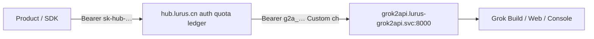

# Grok2API upstream (Hub relay)

**Goal**: other Lurus products call **Hub** (`https://hub.lurus.cn/v1/...`) with a normal Hub token; Hub relays to an in-cluster [chenyme/grok2api](https://github.com/chenyme/grok2api) pool. Products never talk to grok2api directly.



Official **xAI API** remains `ChannelTypeXai=48` (Bifrost-owned). This runbook is the **unofficial** Build/Web/Console pool. Operator owns Grok ToS compliance.

## Deploy grok2api

Manifests: [`deploy/k8s/r6-grok2api/`](../../deploy/k8s/r6-grok2api/README.md).

1. Create `/data/grok2api/config.yaml` from `secret-template.yaml` (jwt + credentialEncryptionKey + admin password).
2. `kubectl apply -k deploy/k8s/r6-grok2api/` after creating Secret `grok2api-config`.
3. Port-forward `:8000`, import accounts, create Client Key `g2a_…`.
4. Confirm newhub NetworkPolicy allows ns `lurus-grok2api` (r6-stage `netpol-nats-egress.yaml`, r6-uat `netpol-egress.yaml`).

## Hub channel

| Field | Value |
|-------|--------|
| Type | **Custom** (`8`) — OpenAI-compatible endpoint |
| Name | `Grok2API (pool)` |
| base_url | `http://grok2api.lurus-grok2api.svc:8000` (no `/v1`) |
| key | grok2api Client Key `g2a_…` |
| models | see table below (must match grok2api `GET /v1/models`) |
| status | `1` enabled after key is real |

SQL seed (disabled placeholder): [`deploy/k8s/r6-stage/seed-grok2api-channel.sql`](../../deploy/k8s/r6-stage/seed-grok2api-channel.sql).

### SSRF (required for cluster DNS → RFC1918)

Creating a private `base_url` fails until SSRF allowlist is set (root → System settings → SSRF, or `PUT /api/option/`):

| option | value |
|--------|--------|
| `fetch_setting.allow_private_ip` | `true` |
| `fetch_setting.ip_filter_mode` | `true` (whitelist) |
| `fetch_setting.ip_list` | JSON array with the grok2api Service ClusterIP `/32`, or the cluster Service CIDR |

Resolve ClusterIP: `kubectl -n lurus-grok2api get svc grok2api -o jsonpath='{.spec.clusterIP}'`.

Do **not** set `allow_private_ip=true` without a tight whitelist.

### Pricing

Unpriced models → `model_price_error`. Seed ratios via Admin → Pricing (tenant `lurus`) for every public model on the channel. Starting point (operator-tunable):

| Model | Suggested `model_ratio` | `completion_ratio` | Notes |
|-------|-------------------------|--------------------|--------|
| `grok-chat-fast` | 0.15 | 4 | Web Basic |
| `grok-chat-auto` | 0.5 | 4 | Web Super |
| `grok-chat-expert` | 1.0 | 4 | Web Super |
| `grok-4.5` | 1.5 | 4 | Build discovery name — confirm via grok2api `/v1/models` |

Image / video models (`grok-imagine-*`) need Hub image/task paths separately; **phase 1 = chat only**.

## Product client contract

Other intelligent products should:

1. Use Hub base URL `https://hub.lurus.cn` (UAT: `https://test-newhub.lurus.cn`).
2. Authenticate with a Hub **user API token** (`Authorization: Bearer sk-…`), not the grok2api `g2a_` key.
3. Call OpenAI-compatible chat:

```bash
curl -sS https://hub.lurus.cn/v1/chat/completions \
  -H "Authorization: Bearer $HUB_TOKEN" \
  -H "Content-Type: application/json" \
  -d '{"model":"grok-chat-fast","messages":[{"role":"user","content":"ping"}],"max_tokens":32}'
```

4. Prefer models listed on the Hub channel / pricing page; discover via Hub `GET /v1/models` after the channel is enabled.

Billing, quotas, multi-tenant isolation, and usage logs stay on **Hub**. grok2api’s own audit is ops-only.

## Smoke

```bash
# In-cluster from a debug pod or newhub pod:
curl -sS -m 10 http://grok2api.lurus-grok2api.svc:8000/healthz
curl -sS -m 30 http://grok2api.lurus-grok2api.svc:8000/v1/models \
  -H "Authorization: Bearer $G2A_KEY"

# Through Hub (product path):
curl -sS -m 60 https://hub.lurus.cn/v1/chat/completions \
  -H "Authorization: Bearer $HUB_TOKEN" \
  -H "Content-Type: application/json" \
  -d '{"model":"grok-chat-fast","messages":[{"role":"user","content":"ping"}],"max_tokens":16}'
```

Expect Hub HTTP 200 + one consume log row; bifrost may count Custom→OpenAI as `engine=bifrost` or legacy depending on ApiType resolution — either is fine as long as PostConsume runs once.

## Rollback

1. Disable Hub channel (`status=2`) or remove models from the channel.
2. Scale grok2api to 0: `kubectl -n lurus-grok2api scale deploy/grok2api --replicas=0`.
3. Netpol allow for `lurus-grok2api` can stay (unused allow is harmless).
